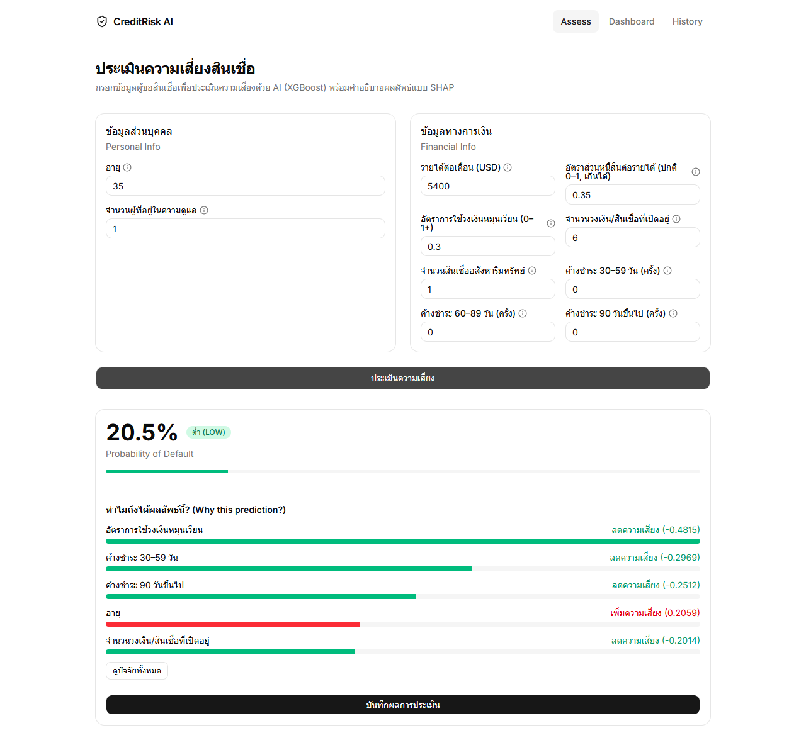

# CreditRisk AI

Credit-risk scoring demo: an XGBoost model trained on the Kaggle
[Give Me Some Credit](https://www.kaggle.com/c/GiveMeSomeCredit) dataset, served by a
FastAPI backend with per-prediction SHAP explanations, and a Next.js web UI (Thai).



> **Educational demo only.** This is not financial advice and must not be used to make
> real lending decisions. See [Limitations](#limitations).

## Features

- XGBoost classifier with class-imbalance weighting and early stopping
- `/predict` API returns a risk score, risk tier (low / medium / high) and the top SHAP factors
- Web UI: assessment form, result explanation, dashboard and history
- Optional Postgres audit log of predictions

## Stack

| Part | Tech |
|---|---|
| Model | XGBoost, SHAP, scikit-learn, pandas |
| API | FastAPI, Pydantic, SQLAlchemy |
| Frontend | Next.js 14, Tailwind, shadcn/ui |
| DB (optional) | PostgreSQL via Docker Compose |

## Getting started

### 1. Backend

```bash
pip install -r requirements.txt
uvicorn main:app --port 9000
```

A trained model (`credit_model.json`) is included, so training is optional.

Environment variables (optional, see `.env.example`):

- `DATABASE_URL` — enables the Postgres audit log
- `CORS_ORIGINS` — comma-separated allowed origins (default `http://localhost:3000,http://127.0.0.1:3000`)

### 2. Frontend

```bash
cd frontend
cp .env.local.example .env.local   # set NEXT_PUBLIC_API_URL=http://localhost:9000
npm install
npm run dev
```

Open http://localhost:3000.

### 3. Audit log database (optional)

```bash
docker compose up -d
```

### Retraining the model

The dataset is not included in this repo. Download it from
[Kaggle](https://www.kaggle.com/c/GiveMeSomeCredit/data), place `cs-training.csv` in
`GiveMeSomeCredit/`, then run:

```bash
python train.py
```

## API

`POST /predict`

```json
{
  "RevolvingUtilizationOfUnsecuredLines": 0.3,
  "age": 35,
  "NumberOfTime30-59DaysPastDueNotWorse": 0,
  "DebtRatio": 0.35,
  "MonthlyIncome": 5400,
  "NumberOfOpenCreditLinesAndLoans": 6,
  "NumberOfTimes90DaysLate": 0,
  "NumberRealEstateLoansOrLines": 1,
  "NumberOfTime60-89DaysPastDueNotWorse": 0,
  "NumberOfDependents": 1
}
```

Other endpoints: `GET /health`, `GET /predictions?limit=20&offset=0` (requires the database).

## Limitations

- **US data from ~2008.** Incomes are in USD and borrower behaviour differs from other
  markets; results do not transfer to e.g. Thai applicants without retraining on local data.
- **Scores are not calibrated probabilities.** Class weighting inflates the output, so a
  "20%" score does not mean a 20% chance of default.
- **Evaluation is optimistic.** The validation set is used both for early stopping and
  for the reported AUC (~0.87); there is no held-out test set yet.
- **No authentication** on the API, and the audit log stores applicant inputs.
- `age` and `NumberOfDependents` are model features; these may be protected attributes
  under lending regulations.

## License

[MIT](LICENSE). The Give Me Some Credit dataset is subject to Kaggle's terms and is not
covered by this license.
